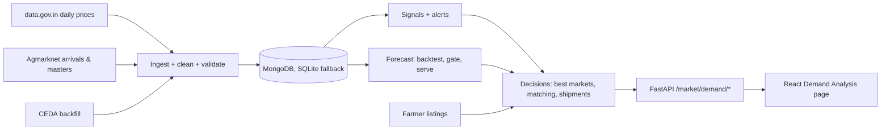

# ALIP Broker Module — Demand Analysis (as built)

This document replaces the broker sections of `alip_farmer_broker_master_report2.md`
(§2.3–2.10, the broker rows of §6 and the broker part of §7) with a description of
the system that is actually implemented on branch `demand-analysis-redesign`.
Every endpoint listed in §9 is checked against the running API by
`backend/check_report_endpoints.py`.

## 1. What changed and why

The earlier report described five analytics engines, a 7-factor ranker and shipment
dispatch. In the code, demand analysis was one regressor trained on 56 hand-typed
rows, with no dates, no market prices and no evaluation. Demo figures were shown
without a label, and a region with no listings received Hyderabad's data.

The rebuilt module rests on one principle: **every number a broker sees traces back
to a recorded mandi observation or to a model that beat simple baselines on past
data.** Where neither exists, the page says "Not enough signal".

Mandi data records prices and arrival quantities, not consumption. "Demand" is therefore
never displayed as a quantity. The module reports an **inferred demand–supply
pressure**, which comes from how prices move relative to arrivals.

## 2. Data sources

| Source | What ALIP uses | Access | Notes |
| :--- | :--- | :--- | :--- |
| data.gov.in resource `9ef84268-d588-465a-a308-a864a43d0070` | Daily min / max / modal price (Rs/quintal) per market, commodity, variety, grade | Official API key | Holds **only the current day** and is wiped overnight, so it is pulled four times between 14:30 and 23:30 IST. A missed day cannot be recovered from this source. The public sample key caps pages at 10 rows, so a registered key is needed. |
| Agmarknet 2.0 (`api.agmarknet.gov.in/v1`) | Commodity and state/district masters; **national** daily arrivals (tonnes) | Public, undocumented | Arrivals cover a fixed list of about 24 major commodities, which excludes banana and rice. The market-level report is behind a captcha and is not used. |
| CEDA, Ashoka University | One-time price history backfill (2000 onward, lagging a few months) | API key | Client implemented but **not yet run**, because no key is available. `mandi_cli.py ceda-probe` checks whether market-level arrivals exist. |
| ALIP farmer listings | Forward supply that has not reached a mandi yet | Own data | ALIP's distinctive signal. |

Scope: tomato, banana, onion, potato, maize, paddy, rice, wheat, cotton, groundnut.

## 3. Architecture



- **Single FastAPI process.** APScheduler runs the jobs inside it. An OS file lock ensures that only one worker schedules, and `mandi_cli.py schedule` runs the scheduler on its own without the API's PyTorch models.
- **Storage.** `services/mandi/store.py` puts one interface in front of MongoDB, with SQLite (`backend/data/mandi.sqlite3`) as the fallback. Upserts are keyed on date, state, district, market, commodity, variety, grade and source, so repeating a pull never creates duplicates.
- **Job schedule (IST):**
  - Price pulls at 14:30, 17:30, 20:30 and 23:30.
  - Arrivals at 16:30.
  - Signals and alerts after every pull.
  - Forecasts at 23:45.
  - Retraining on Sundays at 02:00.
  - Commodity and state masters refreshed weekly.
- **Ingest reports.** Every run records rows reported and fetched, how complete the pull was, rejected rows, flagged rows and errors. `GET /health/data` exposes these reports.

## 4. Demand & anomaly analytics (replaces §2.5)

| Engine in the earlier report | As built | Data needed |
| :--- | :--- | :--- |
| Dynamic absorption threshold (formula) | **Seasonal norm**: median price, or arrivals, in the same ISO week ±1 of the previous three years. Falls back to the median of the previous 8 weeks. | One year of history for the seasonal norm |
| Z-score anomaly | **Robust z** of the weekly log price change, using median and MAD over the previous 26 weeks. Alerts fire at \|z\| ≥ 3. | 9 or more weeks |
| Urgency 1–10 | Uses the report's formula shape and tier multipliers (×2.0 / ×1.3 / ×1.0). Its inputs are observed: how far arrivals exceed normal, the 4-week price fall, the crash z-score and the listing's age. | Any one input |
| 7-day price decay δ | Replaced by the **forecast fan** (P10/P50/P90 at 1, 2 and 4 weeks) and a **break-even week**: the first week in which the destination P50 minus freight falls below the source P50. | A served forecast |
| Seasonal harvest context | **Seasonal index** by month (price ÷ that year's mean, averaged over complete years), and whether next month is typically higher or lower. | Complete years |

**Pressure quadrant** (arrivals ratio > 1.15 counts as "high", following the report's
> 15% oversupply rule; 4-week price change beyond ±5% counts as "rising" or "falling"):

| | Price rising | Price falling |
| :--- | :--- | :--- |
| **Arrivals high** | Strong demand | Glut |
| **Arrivals low** | Supply shortage | Weak demand |

None of the signals look ahead in time: the signals for week *t* use data up to week *t* only, and a test enforces this.

## 5. Forecasting and evaluation

- **Model.** One global `HistGradientBoostingRegressor` per horizon (1, 2, 4 weeks) and quantile (0.1, 0.5, 0.9), which makes nine models. The target is the log price ratio. Features are relative lags of 1–52 weeks, rolling level and volatility, week of year, season, spread against the parent series (market vs state, state vs national), national arrivals ratio, commodity and level.
- **Backtest.** Rolling origin over the last year, with origins every 4 weeks. Each model sees only outcomes known at its origin.
- **Calibration.** Conformalised quantile regression. The raw P10–P90 band covered only about 65% of outcomes, so the band is widened by a correction learnt only from earlier origins' errors.
- **Baselines.** Naive, seasonal naive and a 4-week moving average. Relative MAE is measured against the **strongest** baseline for each series.
- **Promotion gate** (engineering targets):
  - At 1 and 2 weeks, the model beats the baseline on at least 60% of series.
  - P10–P90 coverage is between 70% and 90%.
  - Directional accuracy at 1 week is above 55%.
  - Following the model beats always holding.

  Versions that fail are saved and logged, but never served.

**Validation on synthetic panels** (8 series × 160 weeks, 13 backtest origins):

| Panel | Horizon | Series beating baseline | P10–P90 coverage | Directional accuracy | Relative MAE vs naive | vs seasonal naive | Promoted |
| :--- | :---: | :---: | :---: | :---: | :---: | :---: | :---: |
| Seasonal + mean-reverting | 1 wk | 67% | 89% | 65% | 0.91 | 0.44 | **Yes** |
| | 2 wk | 78% | 86% | 69% | 0.83 | 0.57 | |
| | 4 wk | 89% | 87% | 78% | 0.76 | 0.73 | |
| Random walk (nothing to learn) | 1 wk | 33% | 89% | 47% | 1.00 | 0.20 | **No** |
| | 2 wk | 33% | 83% | 49% | 1.05 | 0.31 | |
| | 4 wk | 11% | 78% | 46% | 1.06 | 0.41 | |

On the random walk the model "beats" seasonal naive (0.20) but not naive (1.00). A gate
that compared only against seasonal naive would have promoted a model that learnt nothing.

**Real data:** not yet evaluated. Daily collection began on 14 October 2026. None of the
35 real series has the 26 weeks of history needed, so every real series currently answers
"Not enough signal". Real backtest figures will replace this paragraph once the CEDA
backfill runs or about six months of daily data accumulate.

## 6. Destination ranking (replaces §2.4)

Destinations within 500 km (straight line × road factor 1.25) are ranked by **expected
margin after freight**. The expected price is the forecast P50 for the arrival week when
a forecast is served; otherwise it is the latest weekly price, with no downside shown.
Each row shows:
- the price basis and how many markets it rests on (flagged as a **thin sample** below 3);
- the P10 downside and its ROI;
- the break-even week.

The report's 7-factor composite is computed from the factors that have data, with their
weights rescaled:

| Factor | Weight | Status |
| :--- | :---: | :--- |
| Demand gap | 0.20 | Active. Uses the destination's pressure quadrant as a proxy for its deficit. |
| Broker reliability | 0.20 | Inactive: no ratings recorded yet |
| Price advantage | 0.15 | Active: Δprice normalised across candidates |
| Transport efficiency | 0.15 | Active: `max(0, 100 − cost per 100 kg / 5)`, the report formula |
| Destination saturation | 0.10 | Active: in-transit kg compared with this shipment (0 above 120%) |
| Storage availability | 0.10 | Inactive: no facility data |
| En-route weather | 0.10 | Inactive: route weather not connected |

## 7. Freight & ROI (§2.6, implemented as written)

| Truck | Capacity | Rate |
| :--- | :---: | :---: |
| Small | 3 t | ₹25/km |
| Medium | 10 t | ₹35/km |
| Large | 20 t | ₹50/km |

ROI = (agreed price − source cost) × Q / (distance × rate). The bands are ≥ 1.5 Good,
1.0–1.5 Acceptable and < 1.0 Loss-Making. The cheapest truck is chosen automatically,
and loads above one truck's capacity use several trucks. Brokers can override rates
and add a commission percentage. The report's worked example (2,500 kg of Guntur tomato,
Hyderabad 280 km, medium truck, ROI 2.1) is reproduced exactly in the tests.

## 8. Alerts, matching and shipments (§2.9, §2.10)

**Alerts.** Duplicates are suppressed for 24 hours.

| Type | Trigger |
| :--- | :--- |
| `glut` | High arrivals and a falling price |
| `supply_shortage` | Low arrivals and a rising price |
| `price_spike` / `price_crash` | Robust z ≥ 3 or ≤ −3 |
| `arrival_surge` | National daily arrivals ≥ 2× the 28-day median |
| `listing_opportunity` | A fresh listing in a state whose market looks tight |
| `listing_match` | A new listing within a broker's radius and watchlist. Sent to that broker only. |

**Matching.** Each broker sets a home region, watchlist, radius, truck, rates and
commission. Listings are scored on margin, distance, seller pressure and truck fill,
weighted 0.35, 0.25, 0.20 and 0.20.

**Shipments.** The lifecycle is `initiated → in_transit → delivered`, and a shipment can
be cancelled before delivery. Illegal transitions return 409. Freight is always computed
on the server. A linked listing moves from available to pending to sold, and returns to
available if the shipment is cancelled.

**Dashboard (§2.3).** The four figures shown are:
- **Market volume:** total kg in farmer listings.
- **Active listings.**
- **Oversupply alerts:** glut and arrival surge.
- **Undersupply alerts:** supply shortage.

## 9. Broker API (replaces the broker part of §7)

All endpoints require a broker JWT except `/health/data` and listing creation, which needs any logged-in user.

```
GET  /health/data                              -> ingestion health, freshness, duplicates
GET  /market/prices/commodities                -> tracked commodities and perishability tiers
GET  /market/prices/history                    -> weekly median, P10/P90 spread, national arrivals
GET  /market/prices/markets                    -> reporting markets for a commodity
GET  /market/demand/overview                   -> pressure heatmap rows + listed supply
GET  /market/demand/alerts                     -> market alerts + this broker's matches
GET  /market/demand/forecast/{commodity}       -> P10/P50/P90 or "Not enough signal"
GET  /market/demand/model                      -> model registry and promotion decision
GET  /market/demand/analysis/{commodity}       -> action card, signals, forecast, best markets
GET  /market/demand/best-markets               -> ranked destinations, ROI, break-even
GET  /market/demand/settings                   -> broker settings and truck table
PUT  /market/demand/settings                   -> save home region, watchlist, rates
GET  /market/demand/matches                    -> farmer listings ranked for this broker
POST /market/demand/initiate-shipment          -> create a shipment (status initiated)
GET  /market/demand/shipments                  -> this broker's shipments
POST /market/demand/shipments/{shipment_id}/status -> in_transit | delivered | cancelled
POST /market/listing/add                       -> farmer listing; triggers broker matching
```

## 10. Technology rows (corrects §6 for the broker module)

| Subsystem | Technology | Location |
| :--- | :--- | :--- |
| Backend core | FastAPI, Python 3.12 | `backend/main.py`, `backend/routes/` |
| Mandi data pipeline | requests, APScheduler 3.x | `backend/services/mandi/` |
| Storage | MongoDB (Motor), SQLite fallback | `services/mandi/store.py` |
| Forecasting | scikit-learn HistGradientBoosting (quantile), conformal calibration | `services/mandi/forecast.py` |
| Ranking, freight, matching | Python | `services/mandi/decisions.py`, `freight.py` |
| Shipments | Python state machine | `services/mandi/shipments.py` |
| Broker client | React 19, Recharts | `frontend/alip-frontend/src/pages/DemandAnalysis.js`, `src/components/demand/` |

## 11. Known limitations

- **Little real history yet.** Forecasts, seasonal norms and most alerts need the CEDA backfill or months of daily pulls.
- **National arrivals only.** Market-level arrival history is unconfirmed until `ceda-probe` runs.
- **Estimated distances.** They are straight-line × 1.25, not routed.
- **Inactive ranking factors.** Reliability, storage and weather are not computed, and broker ratings (1–5 stars after delivery) are not built.
- **Farmer-module endpoints that don't exist.** The master report still lists five that are not implemented: `/disease/active-scans/{loc}`, `/disease/scan/{id}/resolve`, `/weather/dashboard/{loc}`, `/crop/recommend/manual` and `/crop/recommend/regional`.
